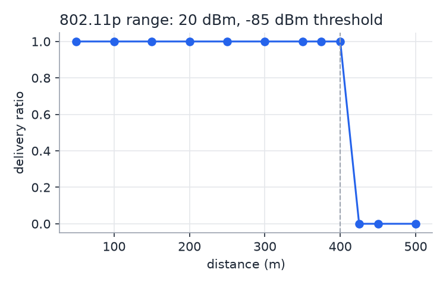
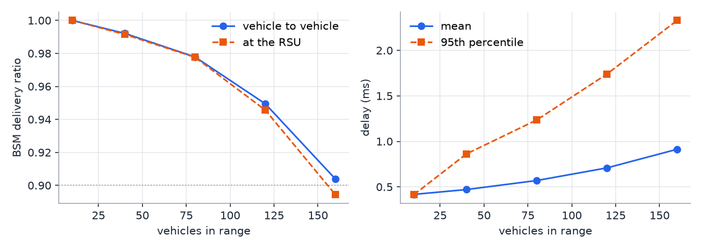
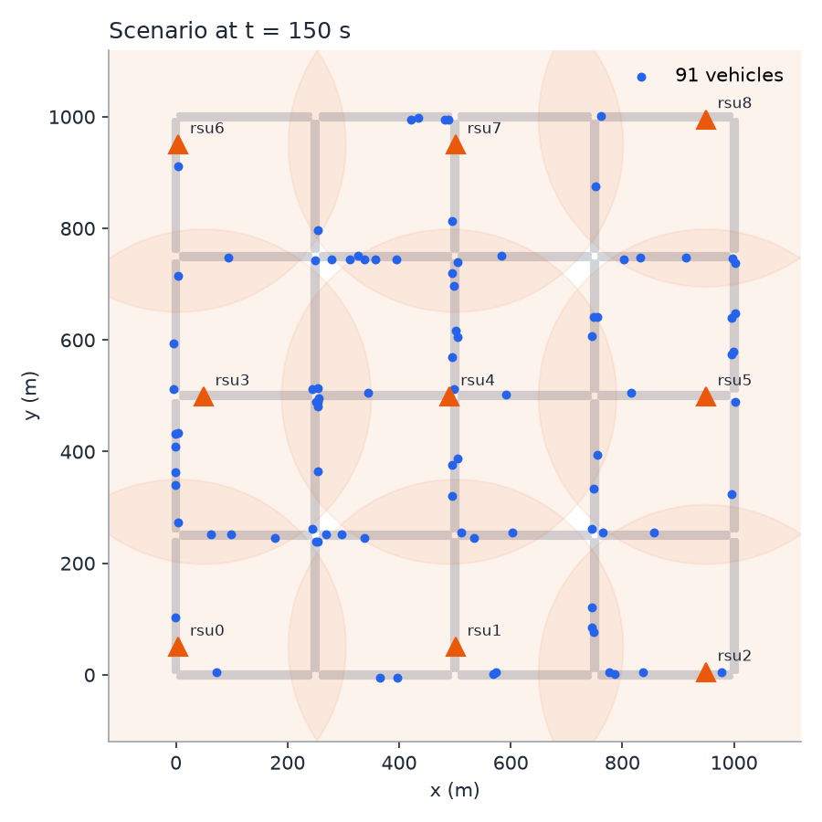
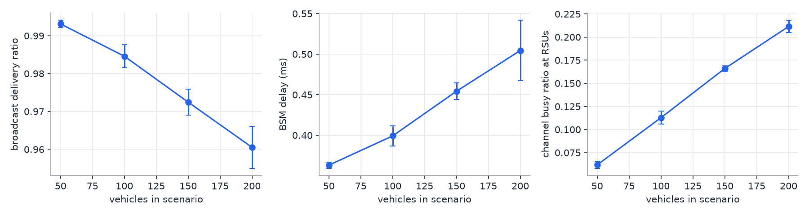

# Simulation setup

*Person 1: mobility and network simulation*

The demo runs in one simulated city. SUMO moves the vehicles on real road
geometry, and ns-3 carries every message between vehicles and roadside units
(RSUs) over an IEEE 802.11p radio. The protocol (Person 3), the detector
(Person 4) and the ledger (Person 2) are plugged into this scenario through
three narrow interfaces, so each part can be developed and tested on its own.

## Pipeline

```
netgenerate / osmWebWizard ──► road network (.net.xml)
randomTrips.py ──────────────► trips, routes (duarouter)
sumo --fcd-output ───────────► floating-car data, 1 s samples
fcd_to_ns2.py ───────────────► trace.ns2 + node_map.csv (SUMO id → ns-3 node id)
place_rsus.py ───────────────► rsus.csv (grid snapped to roads)
run_scenario.py ─────────────► ns-3: Ns2MobilityHelper + 802.11p + apps
                                ├─ vehicle app / RSU app → protocol hooks
                                ├─ ledger bridge → mock ledger or Fabric gateway
                                └─ metrics.csv, summary.json, flowmon.xml, netanim.xml
```

`mobility/build_scenario.py` caches each scenario under
`mobility/out/<net>_v<N>_d<T>_s<seed>/`, so an experiment sweep builds every
case once.

**Why our own ns-2 exporter.** SUMO's `traceExporter.py` leaves each vehicle
at its first position before it departs and at its last position after it
arrives. Those "ghost" cars would sit on the road and use the radio channel.
`fcd_to_ns2.py` writes the same ns-2 format but parks a vehicle at one point
3 km outside the map (out of radio range of every road) whenever it is not on the
road. Its applications are stopped while parked. The check
`mobility/verify_positions.py` compares all 15 471 position samples of the
default scenario with SUMO's output: the largest error is 0.002 m.

## Parameters

### Mobility

| Parameter | Value |
|---|---|
| Road network | synthetic Manhattan grid, 5 × 5 junctions, 250 m blocks (1 km × 1 km); OSM extract or InTAS cut optional (`--osm`, `--net`) |
| Lanes, speed limit | 2 per direction, 13.89 m/s (50 km/h) |
| Intersections | traffic lights (`--tls.guess`) |
| Traffic | `randomTrips.py`, fringe factor 5, minimum trip 300 m, routes validated |
| Vehicles | 100 (default; 50–300 supported), inserted evenly over the first 50 % of the run |
| Duration | 300 s |
| Car-following | SUMO defaults (Krauss), step 1 s, FCD period 1 s |
| Vehicles on the road at once | up to 91 (default scenario, seed 1); mean trip 155 s |
| ns-3 mobility | `Ns2MobilityHelper`: straight-line `setdest` between 1 s samples |
| Live coupling (optional) | `--mobility traci`: SUMO stepped through TraCI every 1 s; positions and velocities pushed into `ConstantVelocityMobilityModel`; matches the FCD positions exactly and gives the same PDR as the exported trace (0.919 vs 0.918, 90 s run) |

### RSU layout

| Parameter | Value |
|---|---|
| Placement | regular grid over the map, each point snapped to the closest road |
| Spacing | 450 m (`--rsu-spacing`; 400–500 m recommended) |
| Count | 9 in the default 1 km² map |
| Service range | 300 m (used by `nearby_rsus()` for make-before-break handover) |
| Mobility | `ConstantPositionMobilityModel` |
| ns-3 node ids | after the vehicles: `N … N+8` |

### Radio and MAC (IEEE 802.11p)

| Parameter | Value |
|---|---|
| Standard | `WIFI_STANDARD_80211p`, 5.9 GHz band |
| Channel width | 10 MHz |
| Data rate | 6 Mb/s (`OfdmRate6MbpsBW10MHz`, constant rate, also for control and broadcast frames) |
| MAC | `AdhocWifiMac`, QoS on (EDCA); BSMs and beacons on AC_VO, other messages on AC_BE |
| Transport | UDP over IPv4, port 4000; broadcast to 255.255.255.255, unicast to the node's address |
| Transmit power | 20 dBm (`TxPowerStart` = `TxPowerEnd`; ns-3's default of ~16 dBm is overridden) |
| Receive threshold | −85 dBm (`RxSensitivity`) |
| Path loss | log-distance, reference loss 47.86 dB at 1 m (free space at 5.9 GHz), exponent 2.196 |
| Resulting range | 400 m (exponent chosen so the received power equals −85 dBm at 400 m; `--range`) |
| Fading | none (default); Nakagami m = 1.5 with `--fading nakagami` |
| Propagation delay | constant speed of light |
| Noise floor | −97 dBm (10 MHz, 7 dB noise figure) |
| Frame airtime | 200-byte BSM: 400 µs (40 µs preamble + 45 OFDM symbols of 8 µs) |

### Applications

| Parameter | Value |
|---|---|
| BSM beaconing | every vehicle on the road, 10 Hz ± 5 % jitter, random start phase |
| BSM size | built and signed by the protocol (`make_bsm`); 200 bytes if no protocol builder |
| RSU beacons | every 100 ms (protocol) |
| Congestion control (optional) | every 1 s: beacon rate halved (min 1 Hz) if the vehicle's channel busy ratio > 0.6, doubled back below 0.42 |
| Processing delays | from Person 3's measurements (`--compute-times`), applied with `node.send(..., delay=...)` |
| Attackers (optional) | `--attacker-ratio`, attacks `const_pos`, `random_pos`, `const_speed`, `random_speed`, `sudden_stop`, `flood` |

### Ledger bridge

| Parameter | Value |
|---|---|
| Reads | local copy, instant in simulated time |
| Writes | sent to the ledger API at once; visible to all RSUs after the returned `commitMs` of simulated time |
| Mock commit time | 500 ms ± 20 % (`--mock-commit-ms`) |
| Real Fabric | REST gateway, writes on a thread pool; results collected when simulated time reaches the expected commit; revocation sync every 1 s (`GET /revoked?since=`) |

## Metrics

| Metric | Definition |
|---|---|
| Per-message delay | receive time − send time (simulated), per message type; for broadcasts, per receiver |
| Broadcast PDR | for each broadcast, every active node within 300 m of the sender at send time is an expected receiver; PDR = received / expected; also per 50 m distance bin |
| Unicast PDR | delivered / sent unicast datagrams (after MAC retries) |
| Channel busy ratio | fraction of each second the RSU's PHY is in TX, RX or CCA_BUSY (ns-3 `WifiPhy/State/State` trace) |
| FlowMonitor | per-flow packets, bytes, delay, jitter (`flowmon.xml`) |
| Ledger | commit time per write (median, 95th percentile), time until the write is visible |

## Validation

*Range test* (`network/range_test.py`): one car broadcasts 100 BSMs to one RSU
at each distance.

| Distance | 100 m | 300 m | 375 m | 400 m | 425 m | 450 m |
|---|---|---|---|---|---|---|
| Received power | −71.8 dBm | −82.3 dBm | −84.4 dBm | −85.0 dBm | −85.6 dBm | −86.1 dBm |
| Delivery ratio | 1.00 | 1.00 | 1.00 | 1.00 | 0.00 | 0.00 |

Same result in ns-3 and in the lite model. In ns-3 this needs the
preamble-detection `MinimumRssi` and `CcaSensitivity` lowered from their
default −82 dBm to the −85 dBm receive threshold; with the defaults frames
below −82 dBm are dropped and the range shrinks to about 250 m.



*Density test* (`network/density_test.py`): N vehicles stand at random points
within 150 m of an RSU and all beacon 200-byte BSMs at 10 Hz for 10 s.

| Vehicles in range | 10 | 40 | 80 | 120 | 160 |
|---|---|---|---|---|---|
| BSM delivery ratio (ns-3) | 1.000 | 0.992 | 0.978 | 0.949 | 0.904 |
| Mean delay, ms (ns-3) | 0.42 | 0.47 | 0.57 | 0.71 | 0.91 |
| 95th percentile delay, ms (ns-3) | 0.41 | 0.86 | 1.24 | 1.74 | 2.33 |
| RSU channel busy ratio (ns-3) | 0.03 | 0.13 | 0.26 | 0.38 | 0.49 |
| BSM delivery ratio (lite model) | 1.000 | 0.993 | 0.968 | 0.930 | 0.871 |

Delivery stays above 90 % up to 160 vehicles in range (target: up to about
80); losses come from frames whose backoff ends in the same slot. The lite
model is slightly pessimistic at high load but within 3.5 points of ns-3.



*Full scenario* (100 vehicles, 9 RSUs, 300 s, stand-in protocol, 5 %
attackers):

| Metric | Value |
|---|---|
| Metric | ns-3 | lite model |
|---|---|---|
| BSM delivery ratio within 300 m | 0.988 (1.000 at < 50 m, 0.979 at 250–300 m) | 0.941 |
| BSM delay | mean 0.39 ms, 95th percentile 0.74 ms | mean 0.42 ms, p95 0.63 ms |
| Unicast delivery (after MAC retries) | 0.999 (FlowMonitor: 3 608 of 3 609 packets) | 0.998 |
| RSU channel busy ratio | mean 0.086 | mean 0.044 |
| Full authentication, request to ticket | median 1.5 ms, 95th percentile 14.3 ms (809) | median 1.6 ms, p95 7.3 ms |
| Handover via the ledger record | median 1.4 ms, 95th percentile 16.2 ms (527) | median 1.1 ms, p95 5.6 ms |
| Ledger write visible to other RSUs | median 503 ms (mock commit time 500 ms ± 20 %) | same |
| Attackers revoked, identity revealed | 3 of 5 (stand-in detector), all their pseudonyms revoked | 3 of 5 |
| Wall-clock time | 201 s | 45 s |

*(Seed 1. The longer authentication tail in ns-3 is probably ARP resolution
before the first unicast to a node, which the lite model does not simulate;
not yet confirmed. Authentication times exclude
cryptographic compute; pass Person 3's measurements with `--compute-times`.)*



*Density sweep* (`network/density_sweep.py`): the full scenario with 50–200
vehicles, 120 s, seeds 1–3, mean ± 95 % confidence interval.

| Vehicles in scenario | 50 | 100 | 150 | 200 |
|---|---|---|---|---|
| BSM delivery ratio, ≤ 300 m (ns-3) | 0.993 ± 0.001 | 0.985 ± 0.003 | 0.972 ± 0.003 | 0.961 ± 0.006 |
| BSM delay, ms (ns-3) | 0.36 ± 0.00 | 0.40 ± 0.01 | 0.45 ± 0.01 | 0.50 ± 0.04 |
| RSU channel busy ratio (ns-3) | 0.062 ± 0.004 | 0.113 ± 0.007 | 0.166 ± 0.003 | 0.211 ± 0.007 |
| BSM delivery ratio (lite model) | 0.965 ± 0.001 | 0.924 ± 0.008 | 0.864 ± 0.031 | 0.809 ± 0.020 |

On the moving scenario the lite model is clearly pessimistic (0.81 against
0.96 at 200 vehicles), unlike in the static density test where it was close
to ns-3. Use ns-3 for every reported figure; the lite model is only for
development and tests.



## Implementation notes

- **Python only.** The scenario is written in Python on top of ns-3's
  cppyy bindings. Calls from C++ back into Python (packet receive, scheduled
  events, PHY state trace) go through a small C++ layer compiled at start-up
  with `cppyy.cppdef`; payloads cross the boundary as hex strings.
- **Protocol isolation.** Protocol code sees only `on_receive`, `send` and
  `schedule` (docs/interfaces.md §3). It never imports ns-3, so Person 3 tests
  it without a simulator.
- **Lite backend.** For machines without ns-3 (Windows) and for unit tests,
  `network/backend_lite.py` models the same radio: log-distance path loss,
  OFDM airtime, EDCA backoff with carrier sense, SINR-based reception with
  interference and preamble locking, half duplex and unicast retries.
  It matches ns-3 on range and on the static density test, but underestimates
  delivery in the moving scenario, so reported results come from ns-3.
- **Scale.** ns-3 slows down past about 150 vehicles in one area. Keep the
  map small while developing.
