# Results: final_attacks

Mean ± 95 % confidence interval over the seeds. Latencies are simulated time (radio + queueing + the measured compute times). `–` = not measured in this setting.

| metric | attack=const_pos | attack=const_speed | attack=flood | attack=random_pos | attack=random_speed | attack=sudden_stop |
|---|---|---|---|---|---|---|
| auth latency, median (ms) | 1.60 ± 0.02 | 1.60 ± 0.02 | 1.61 ± 0.02 | 1.60 ± 0.02 | 1.61 ± 0.02 | 1.60 ± 0.02 |
| auth latency, p95 (ms) | 2.90 ± 0.22 | 2.76 ± 0.48 | 2.85 ± 0.67 | 2.76 ± 0.48 | 2.74 ± 0.40 | 2.76 ± 0.48 |
| handover latency, median (ms) | 1.07 ± 0.02 | 1.06 ± 0.03 | 1.07 ± 0.02 | 1.06 ± 0.03 | 1.07 ± 0.02 | 1.06 ± 0.03 |
| auth success | 1.000 | 0.998 ± 0.007 | 1.000 | 0.998 ± 0.007 | 0.998 ± 0.007 | 0.998 ± 0.007 |
| handover success | 0.993 ± 0.007 | 0.986 ± 0.005 | 0.984 ± 0.011 | 0.986 ± 0.005 | 0.987 ± 0.007 | 0.986 ± 0.005 |
| handovers via PREAUTH | 0.39 ± 0.05 | 0.40 ± 0.04 | 0.39 ± 0.05 | 0.40 ± 0.04 | 0.40 ± 0.04 | 0.40 ± 0.04 |
| BSM PDR | 0.991 ± 0.002 | 0.991 ± 0.003 | 0.989 ± 0.001 | 0.991 ± 0.003 | 0.991 ± 0.003 | 0.991 ± 0.003 |
| channel busy (RSU) | 0.084 ± 0.005 | 0.083 ± 0.005 | 0.095 ± 0.006 | 0.083 ± 0.005 | 0.083 ± 0.005 | 0.083 ± 0.005 |
| security bytes / BSM | 144 ± 0 | 144 ± 0 | 144 ± 0 | 144 ± 0 | 144 ± 0 | 144 ± 0 |
| attackers reported | 0.94 ± 0.24 | 1.00 | 1.00 | 1.00 | 1.00 | 1.00 |
| attackers revoked | 0.67 | 1.00 | 1.00 | 1.00 | 1.00 | 1.00 |
| first lie -> report, median (s) | 0.96 ± 3.08 | 1.06 ± 0.15 | 0.16 ± 0.02 | 0.26 ± 0.08 | 1.09 ± 0.15 | 1.06 ± 0.15 |
| report -> revocation (s) | 10.48 ± 11.81 | 2.34 ± 2.41 | 2.36 ± 2.31 | 2.36 ± 2.38 | 2.33 ± 2.36 | 2.34 ± 2.41 |
| first lie -> identity reveal (s) | 15.07 ± 11.71 | 4.59 ± 1.92 | 3.86 ± 2.05 | 3.86 ± 2.44 | 4.70 ± 2.44 | 4.75 ± 2.36 |
| honest flagged | 0.0 | 0.0 | 0.0 | 0.0 | 0.0 | 0.0 |
| honest reported | 0.0 | 0.0 | 0.0 | 0.0 | 0.0 | 0.0 |
| honest revoked | 0.0 | 0.0 | 0.0 | 0.0 | 0.0 | 0.0 |
| pseudonym changes / vehicle | 1.4 ± 0.1 | 1.5 ± 0.2 | 1.5 ± 0.2 | 1.5 ± 0.2 | 1.5 ± 0.2 | 1.5 ± 0.2 |
| seeds | 3 | 3 | 3 | 3 | 3 | 3 |

## Which detector checks fired

Counted once per pseudonym and RSU (the first flag). Honest flags alone revoke nothing: a pseudonym is reported after K flagged BSMs out of W, and revoked when 2 different RSUs report it.

| check | flags on attackers | flags on honest vehicles |
|---|---|---|
| msg_rate | 42 | 0 |
| pos_jump | 48 | 0 |
| pos_speed | 155 | 0 |
| range | 50 | 0 |
| speed_cons | 21 | 0 |

## Figures

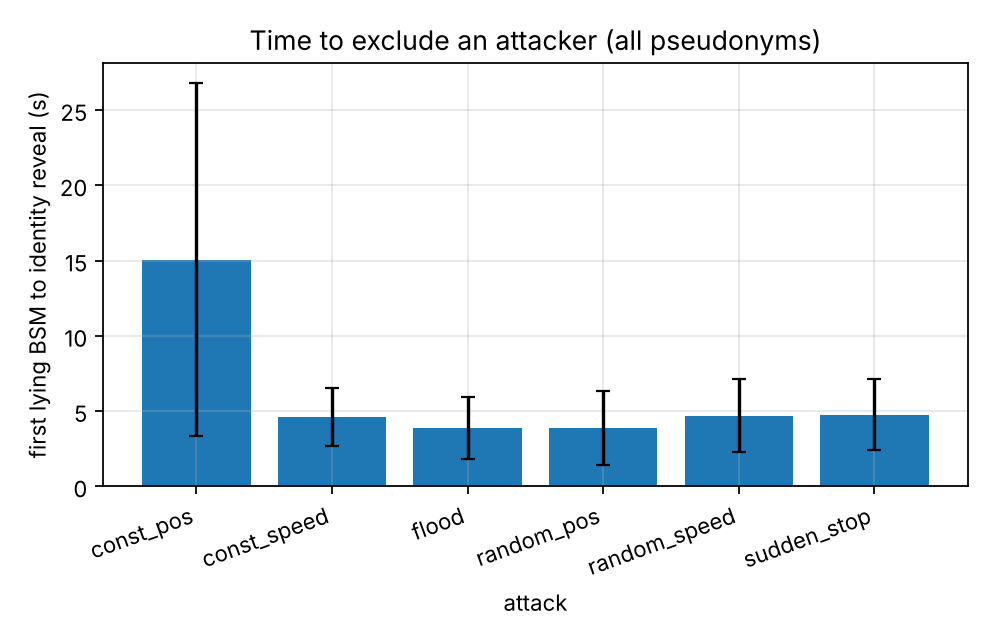
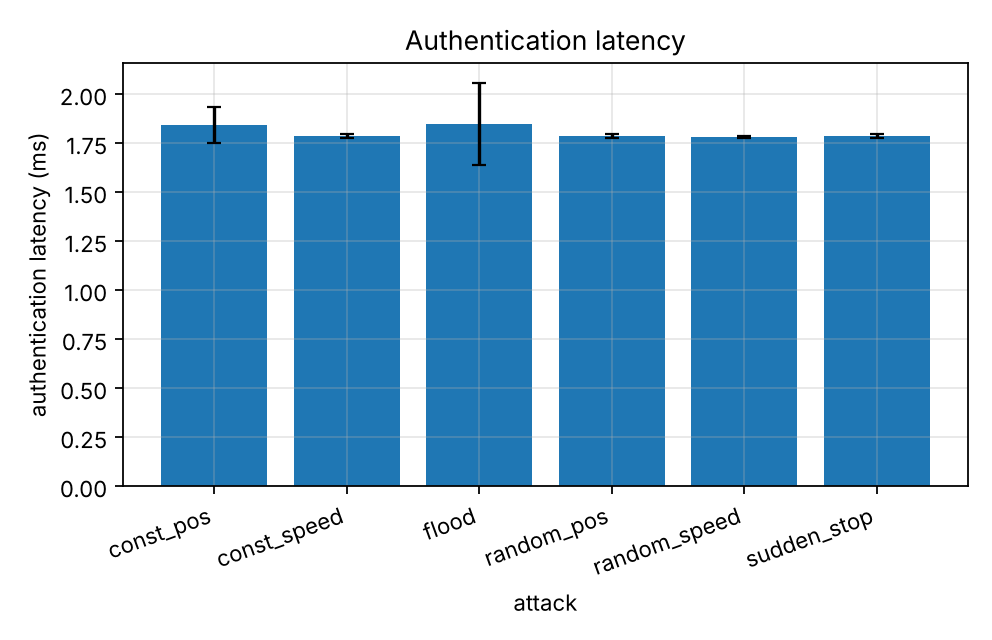
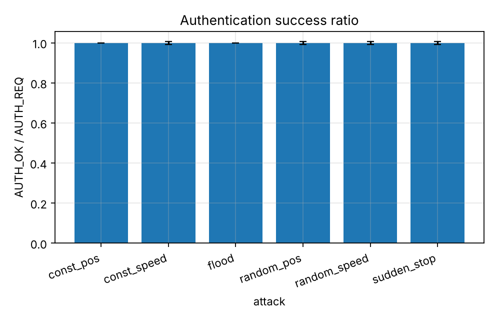
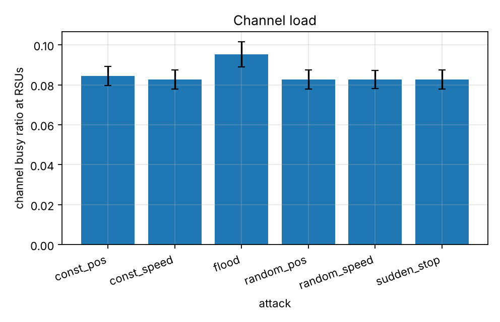

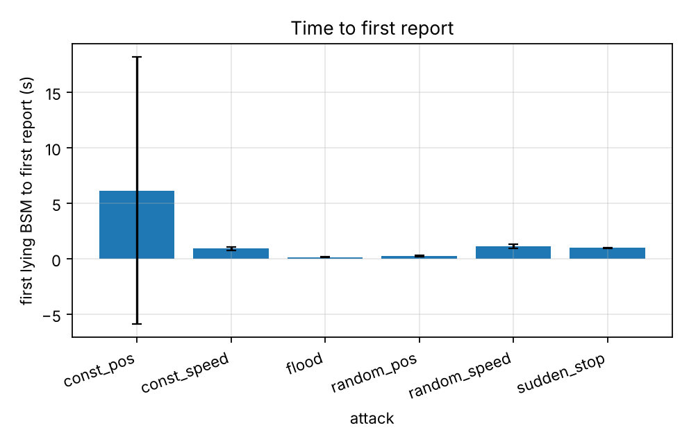
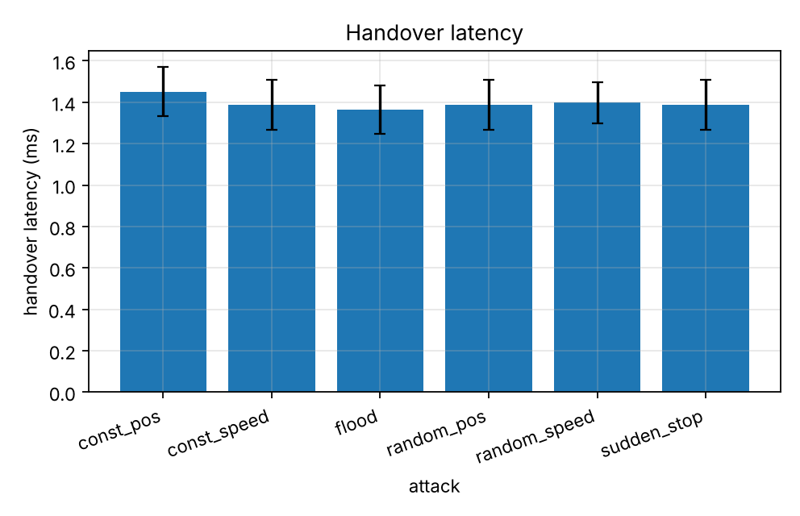
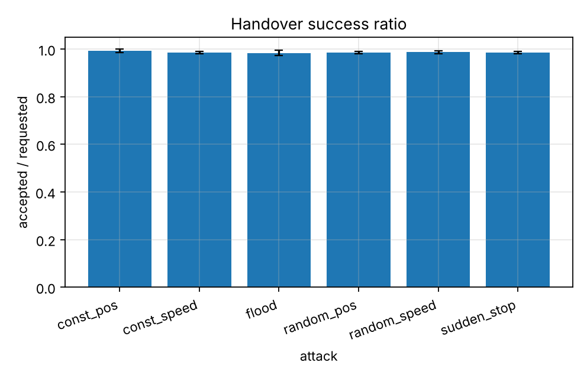
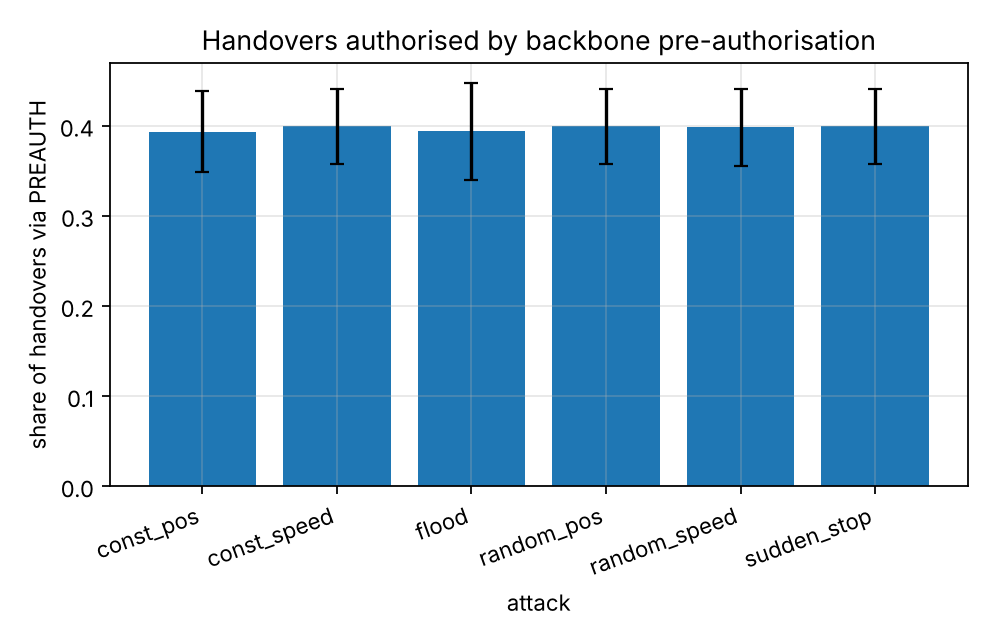
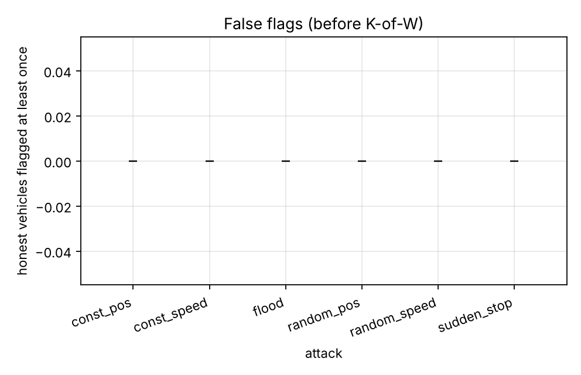

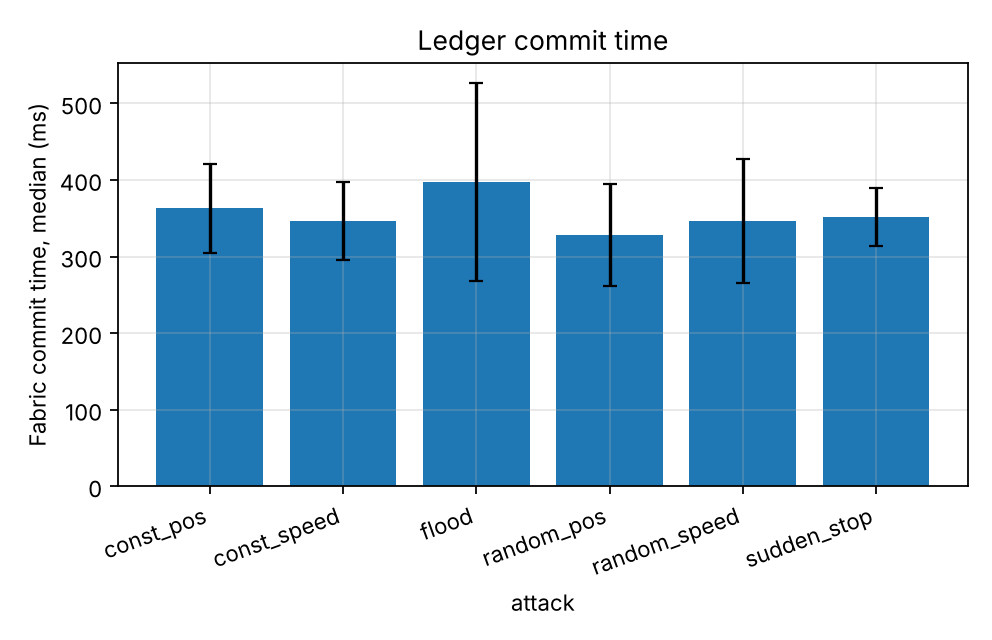
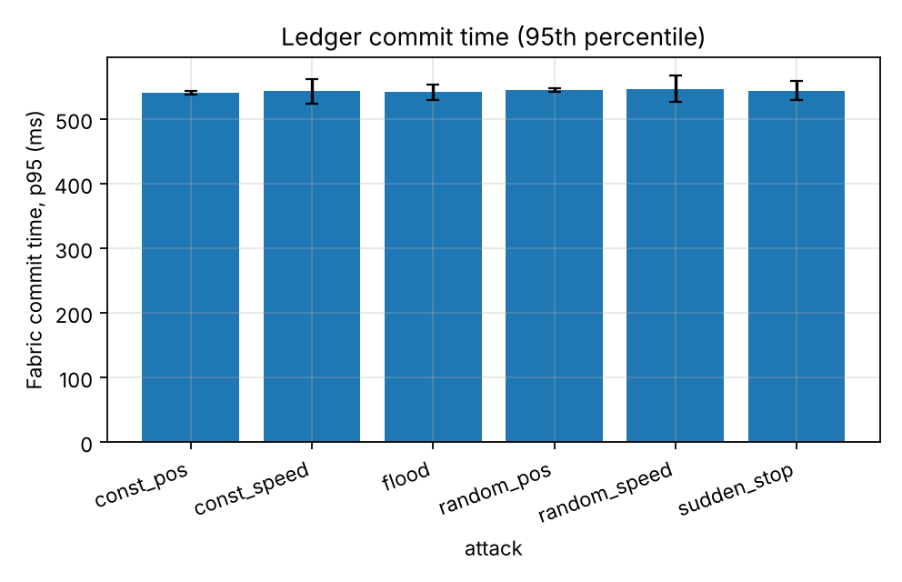
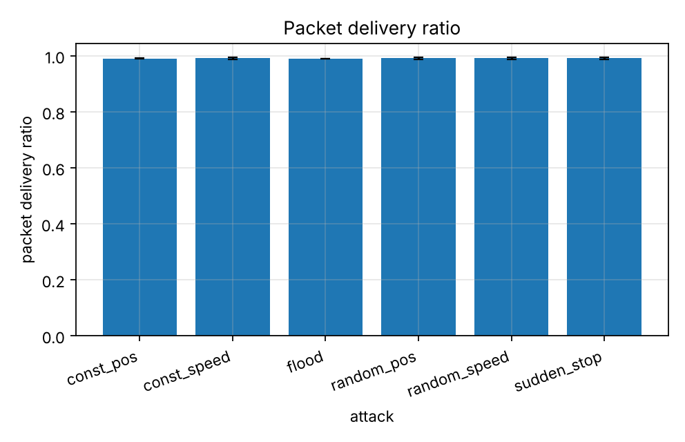
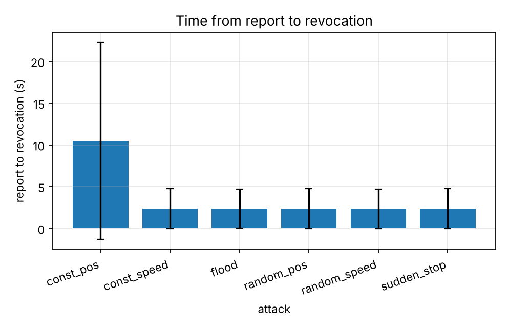
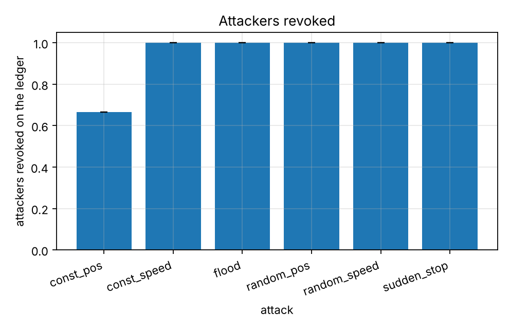
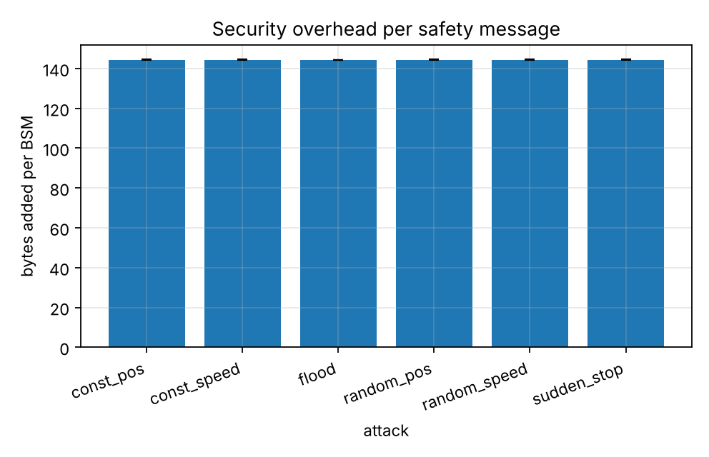
