# Results: presentation_attacks

Mean ± 95 % confidence interval over the seeds. Latencies are simulated time (radio + queueing + the measured compute times). `–` = not measured in this setting.

| metric | attack=const_pos | attack=const_speed | attack=flood | attack=random_pos | attack=random_speed | attack=sudden_stop |
|---|---|---|---|---|---|---|
| auth latency, median (ms) | 1.97 ± 0.08 | 1.96 ± 0.06 | 1.96 ± 0.07 | 1.96 ± 0.06 | 1.96 ± 0.06 | 1.96 ± 0.06 |
| auth latency, p95 (ms) | 4.72 ± 4.40 | 4.38 ± 3.18 | 3.86 ± 0.50 | 4.38 ± 3.18 | 4.39 ± 3.15 | 4.38 ± 3.18 |
| handover latency, median (ms) | 1.60 ± 0.22 | 1.59 ± 0.24 | 1.68 ± 0.31 | 1.59 ± 0.24 | 1.60 ± 0.23 | 1.59 ± 0.24 |
| auth success | 1.000 | 1.000 | 0.998 ± 0.007 | 1.000 | 1.000 | 1.000 |
| handover success | 0.996 ± 0.009 | 0.990 ± 0.004 | 0.992 ± 0.008 | 0.990 ± 0.004 | 0.991 ± 0.005 | 0.990 ± 0.004 |
| handovers via PREAUTH | 0.32 ± 0.06 | 0.31 ± 0.04 | 0.29 ± 0.03 | 0.31 ± 0.04 | 0.31 ± 0.04 | 0.31 ± 0.04 |
| BSM PDR | 0.949 ± 0.007 | 0.951 ± 0.006 | 0.944 ± 0.005 | 0.951 ± 0.006 | 0.951 ± 0.007 | 0.951 ± 0.006 |
| channel busy (RSU) | 0.042 ± 0.002 | 0.041 ± 0.003 | 0.048 ± 0.002 | 0.041 ± 0.003 | 0.041 ± 0.003 | 0.041 ± 0.003 |
| security bytes / BSM | 145 ± 0 | 145 ± 0 | 144 ± 0 | 145 ± 0 | 145 ± 0 | 145 ± 0 |
| attackers reported | 0.94 ± 0.24 | 1.00 | 1.00 | 1.00 | 1.00 | 1.00 |
| attackers revoked | 0.67 | 1.00 | 1.00 | 1.00 | 1.00 | 1.00 |
| first lie -> report, median (s) | 0.97 ± 3.05 | 1.07 ± 0.13 | 0.16 ± 0.02 | 0.26 ± 0.06 | 1.10 ± 0.14 | 1.07 ± 0.13 |
| report -> revocation (s) | 10.57 ± 11.91 | 2.42 ± 2.44 | 2.41 ± 2.37 | 2.43 ± 2.32 | 2.44 ± 2.42 | 2.42 ± 2.44 |
| first lie -> identity reveal (s) | 15.23 ± 12.19 | 4.86 ± 2.78 | 3.97 ± 2.53 | 4.03 ± 2.77 | 5.03 ± 2.44 | 5.03 ± 2.77 |
| honest flagged | 0.0 | 0.0 | 0.0 | 0.0 | 0.0 | 0.0 |
| honest reported | 0.0 | 0.0 | 0.0 | 0.0 | 0.0 | 0.0 |
| honest revoked | 0.0 | 0.0 | 0.0 | 0.0 | 0.0 | 0.0 |
| pseudonym changes / vehicle | 1.4 ± 0.2 | 1.6 ± 0.3 | 1.6 ± 0.2 | 1.6 ± 0.3 | 1.6 ± 0.3 | 1.6 ± 0.3 |
| seeds | 3 | 3 | 3 | 3 | 3 | 3 |

## Which detector checks fired

Counted once per pseudonym and RSU (the first flag). Honest flags alone revoke nothing: a pseudonym is reported after K flagged BSMs out of W, and revoked when 2 different RSUs report it.

| check | flags on attackers | flags on honest vehicles |
|---|---|---|
| msg_rate | 42 | 0 |
| pos_jump | 48 | 0 |
| pos_speed | 155 | 0 |
| range | 51 | 0 |
| speed_cons | 22 | 0 |

## Figures

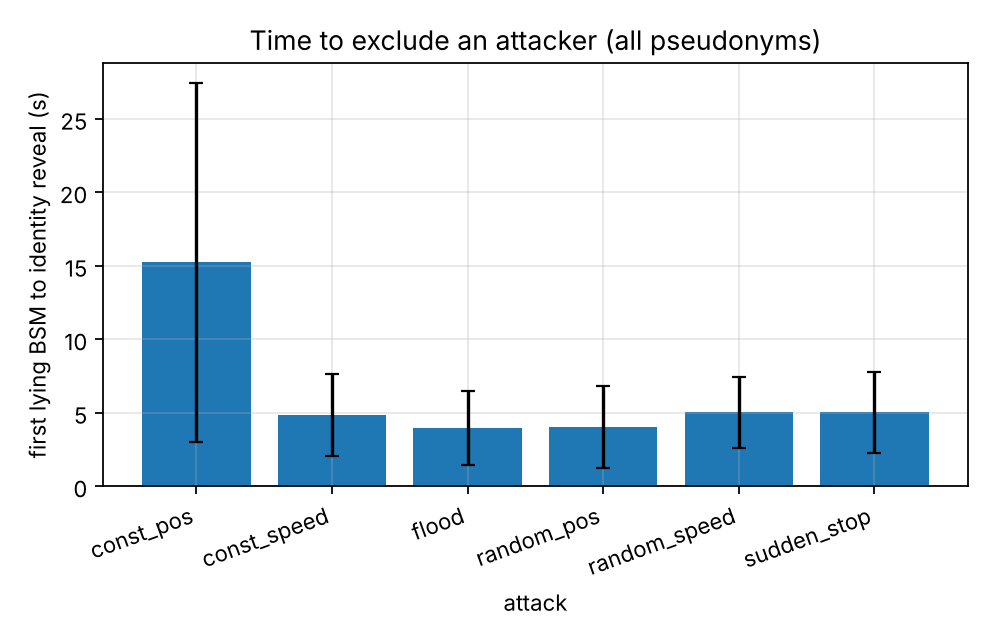
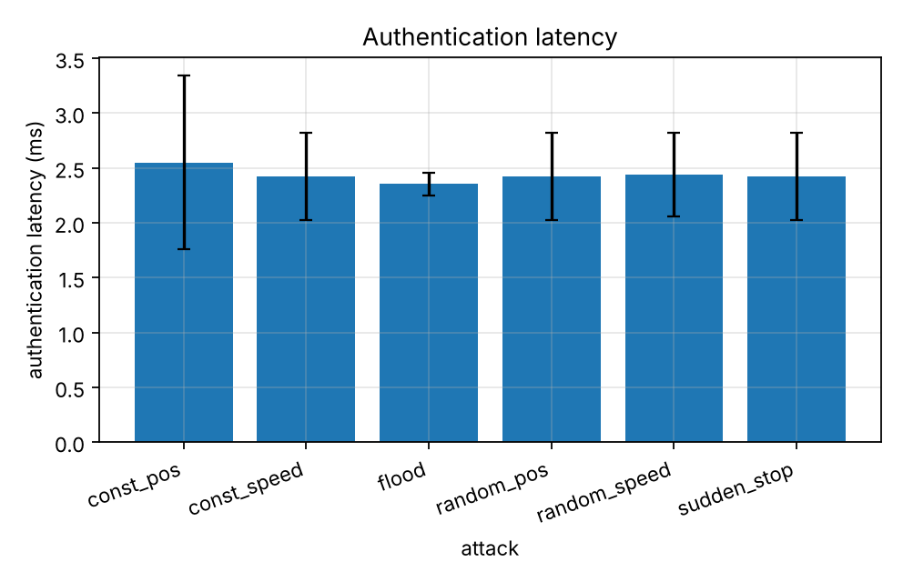
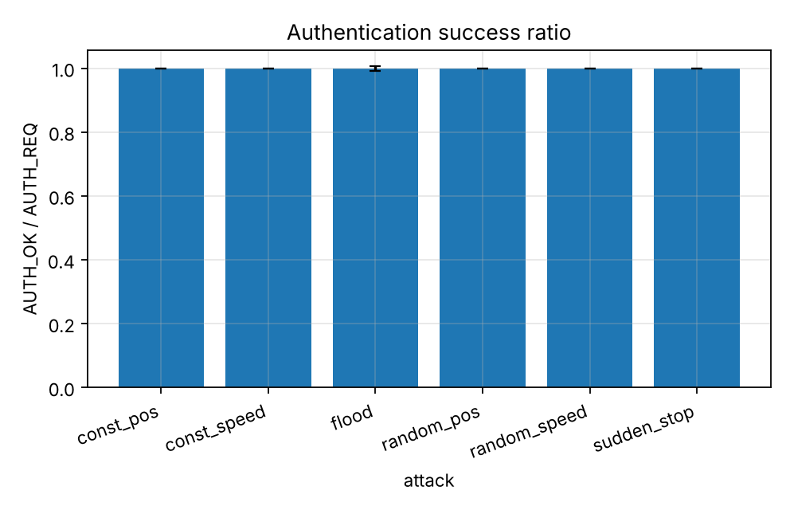
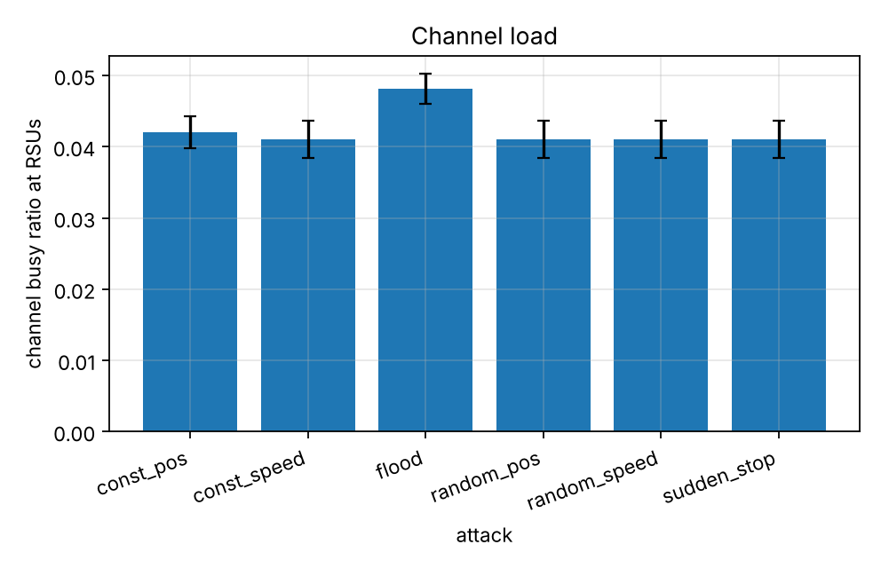
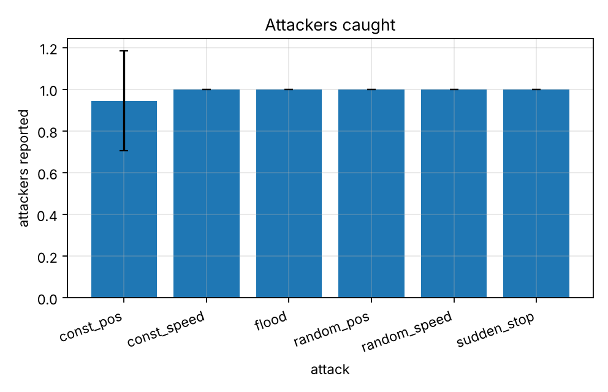
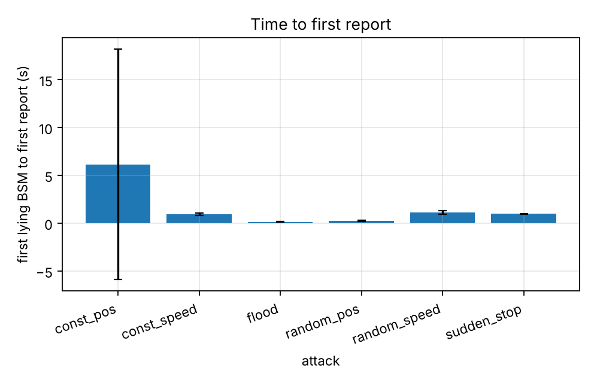
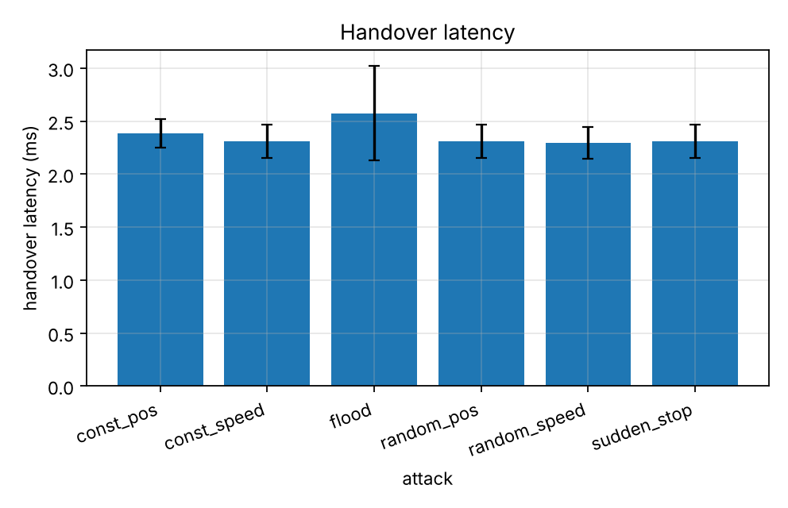

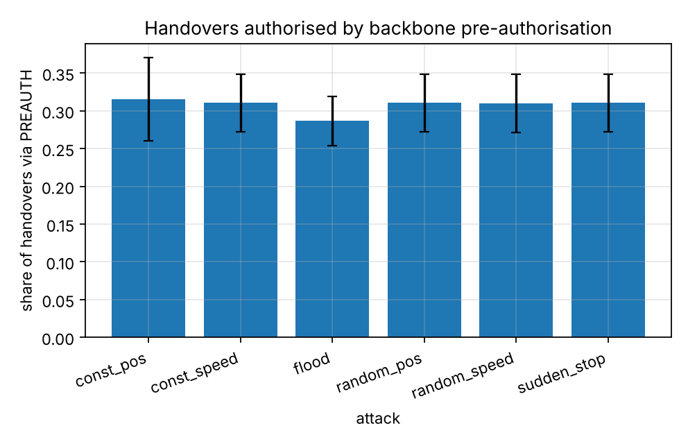

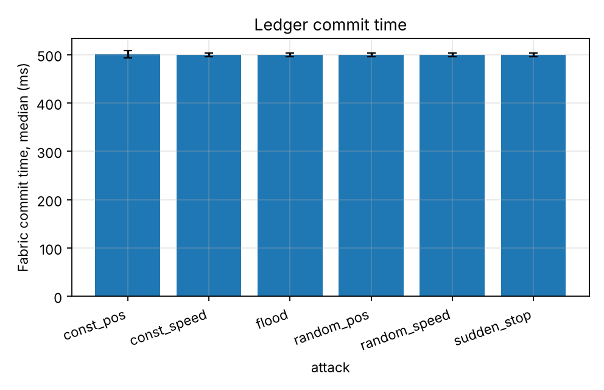
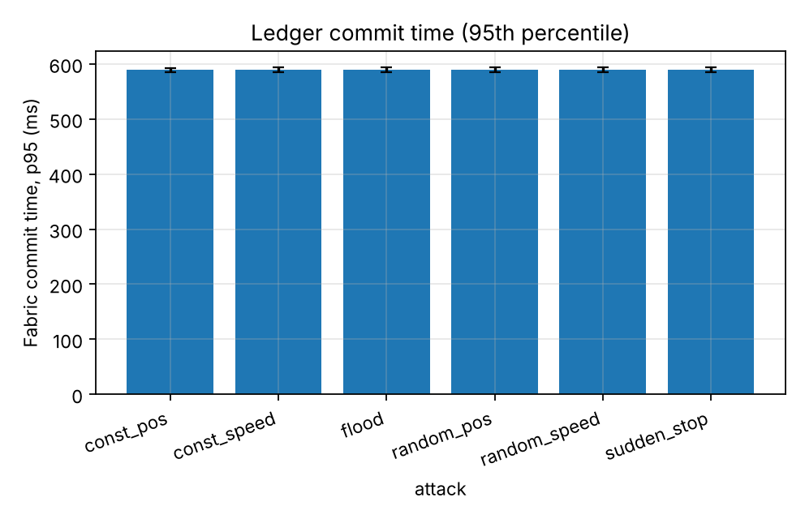
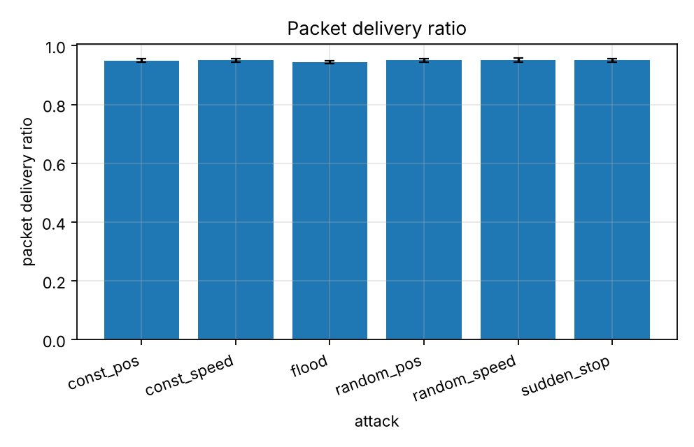
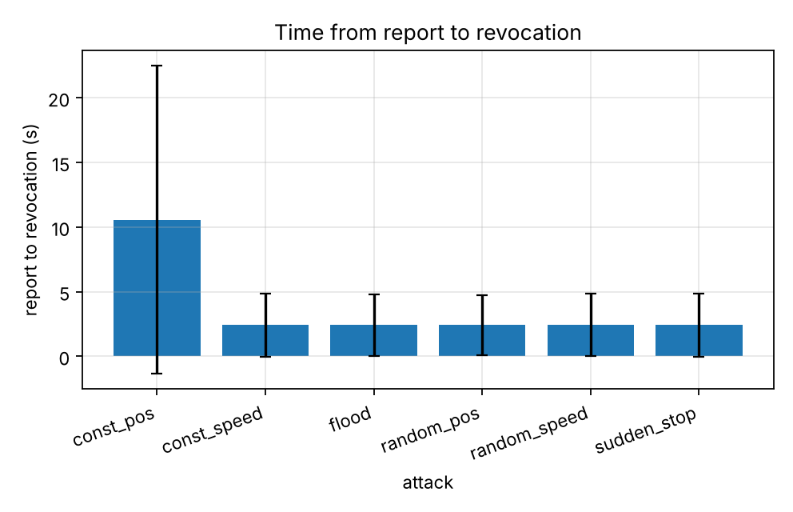

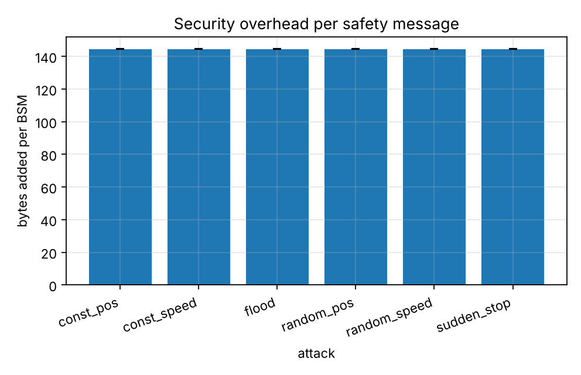
