# Results: presentation_schemes

Mean ± 95 % confidence interval over the seeds. Latencies are simulated time (radio + queueing + the measured compute times). `–` = not measured in this setting.

| metric | protocol=experiments.baselines.central_auth, vehicles=30 | protocol=experiments.baselines.central_auth, vehicles=60 | protocol=experiments.baselines.central_auth, vehicles=90 | protocol=experiments.baselines.ecdsa_pki, vehicles=30 | protocol=experiments.baselines.ecdsa_pki, vehicles=60 | protocol=experiments.baselines.ecdsa_pki, vehicles=90 | protocol=real, vehicles=30 | protocol=real, vehicles=60 | protocol=real, vehicles=90 |
|---|---|---|---|---|---|---|---|---|---|
| auth latency, median (ms) | 22.23 ± 0.05 | 22.25 ± 0.07 | 22.28 ± 0.02 | 1.23 ± 0.02 | 1.28 ± 0.05 | 1.43 ± 0.12 | 1.88 ± 0.02 | 1.97 ± 0.07 | 2.18 ± 0.43 |
| auth latency, p95 (ms) | 22.94 ± 0.46 | 23.76 ± 2.48 | 24.97 ± 1.42 | 2.31 ± 1.00 | 3.27 ± 1.47 | 5.03 ± 1.47 | 3.28 ± 0.19 | 4.38 ± 3.18 | 7.25 ± 4.04 |
| handover latency, median (ms) | 22.16 ± 0.05 | 22.20 ± 0.07 | 22.26 ± 0.06 | 1.18 ± 0.02 | 1.23 ± 0.07 | 1.39 ± 0.10 | 1.42 ± 0.07 | 1.59 ± 0.22 | 1.94 ± 0.07 |
| auth success | 1.000 | 1.000 | 1.000 | 1.000 | 1.000 | 1.000 | 1.000 | 1.000 | 1.000 |
| handover success | 0.990 ± 0.026 | 0.991 ± 0.015 | 0.992 ± 0.006 | 0.990 ± 0.026 | 0.989 ± 0.013 | 0.992 ± 0.007 | 0.987 ± 0.014 | 0.990 ± 0.004 | 0.993 ± 0.006 |
| handovers via PREAUTH | 0.00 | 0.00 | 0.00 | 0.00 | 0.00 | 0.00 | 0.36 ± 0.03 | 0.31 ± 0.04 | 0.29 ± 0.08 |
| BSM PDR | 0.976 ± 0.011 | 0.960 ± 0.004 | 0.942 ± 0.008 | 0.976 ± 0.012 | 0.961 ± 0.005 | 0.941 ± 0.009 | 0.976 ± 0.008 | 0.951 ± 0.006 | 0.928 ± 0.010 |
| channel busy (RSU) | 0.018 ± 0.000 | 0.033 ± 0.002 | 0.047 ± 0.004 | 0.018 ± 0.000 | 0.033 ± 0.001 | 0.047 ± 0.004 | 0.022 ± 0.001 | 0.041 ± 0.003 | 0.060 ± 0.005 |
| security bytes / BSM | 72 | 72 | 72 | 72 | 72 | 72 | 144 ± 0 | 145 ± 0 | 145 ± 0 |
| attackers reported | 1.00 | 1.00 | 1.00 | 1.00 | 1.00 | 1.00 | 1.00 | 1.00 | 1.00 |
| attackers revoked | 1.00 | 1.00 | 1.00 | 1.00 | 1.00 | 1.00 | 1.00 | 1.00 | 1.00 |
| first lie -> report, median (s) | 0.24 ± 0.15 | 0.25 ± 0.05 | 0.24 ± 0.05 | 0.25 ± 0.18 | 0.25 ± 0.05 | 0.27 ± 0.04 | 0.29 ± 0.14 | 0.26 ± 0.06 | 0.28 ± 0.02 |
| report -> revocation (s) | 1.10 ± 1.41 | 2.39 ± 2.62 | 3.47 ± 4.13 | 1.10 ± 1.41 | 2.32 ± 2.73 | 3.45 ± 4.08 | 1.07 ± 1.05 | 2.43 ± 2.32 | 3.46 ± 4.04 |
| first lie -> identity reveal (s) | 2.63 ± 1.43 | 4.02 ± 2.76 | 5.21 ± 4.80 | 2.64 ± 1.44 | 4.03 ± 2.76 | 5.22 ± 4.79 | 2.64 ± 1.40 | 4.03 ± 2.77 | 5.34 ± 4.73 |
| honest flagged | 0.0 | 0.0 | 0.3 ± 1.4 | 0.0 | 0.0 | 0.3 ± 1.4 | 0.0 | 0.0 | 0.3 ± 1.4 |
| honest reported | 0.0 | 0.0 | 0.0 | 0.0 | 0.0 | 0.0 | 0.0 | 0.0 | 0.0 |
| honest revoked | 0.0 | 0.0 | 0.0 | 0.0 | 0.0 | 0.0 | 0.0 | 0.0 | 0.0 |
| pseudonym changes / vehicle | 3.1 ± 1.1 | 3.1 ± 1.0 | 3.1 ± 0.9 | 3.1 ± 1.1 | 3.2 ± 0.8 | 3.1 ± 0.9 | 1.6 ± 0.1 | 1.6 ± 0.3 | 1.6 ± 0.2 |
| seeds | 3 | 3 | 3 | 3 | 3 | 3 | 3 | 3 | 3 |

## Which detector checks fired

Counted once per pseudonym and RSU (the first flag). Honest flags alone revoke nothing: a pseudonym is reported after K flagged BSMs out of W, and revoked when 2 different RSUs report it.

| check | flags on attackers | flags on honest vehicles |
|---|---|---|
| heading | 0 | 6 |
| pos_jump | 272 | 0 |
| pos_speed | 111 | 0 |
| range | 199 | 0 |

## Figures

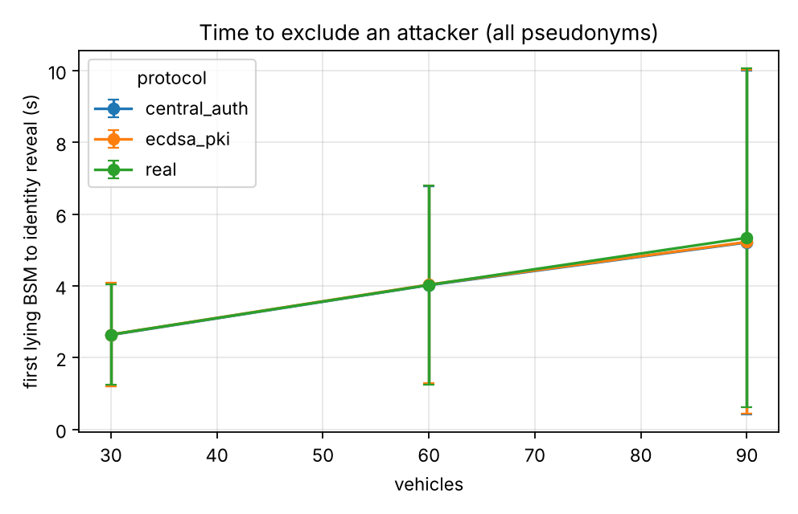
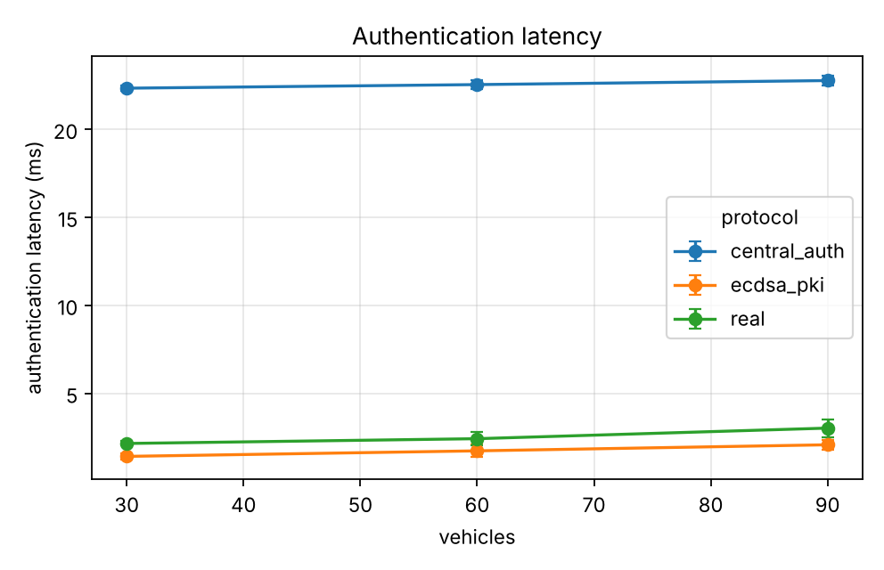
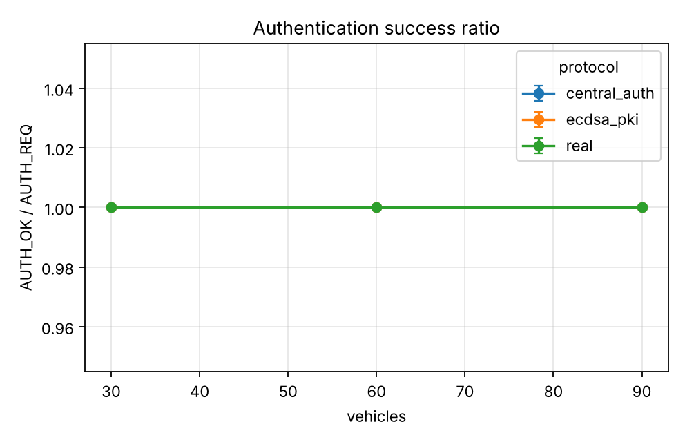
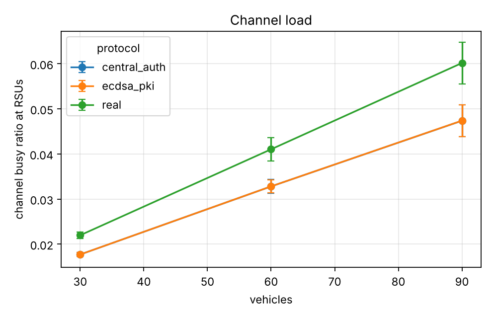

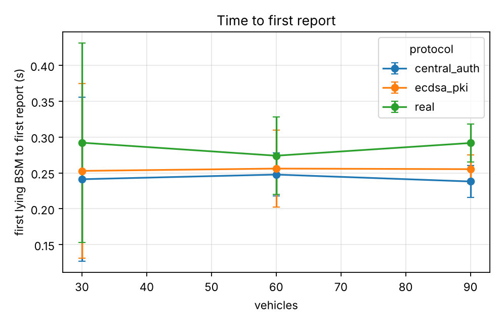
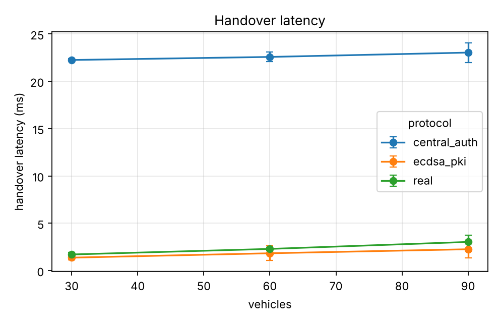
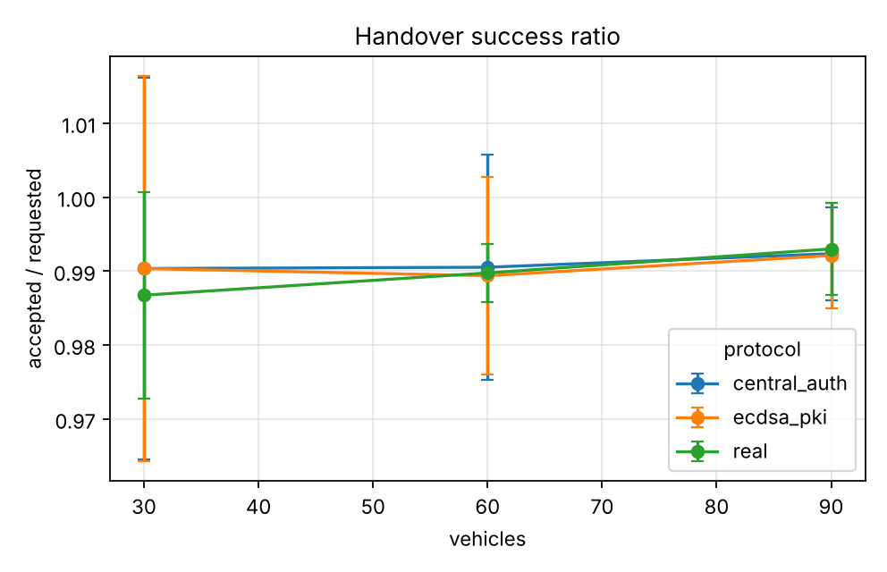
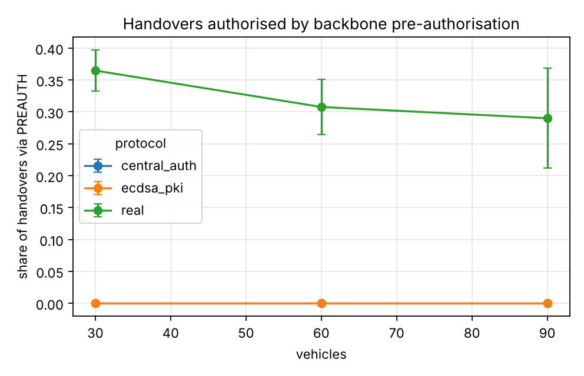

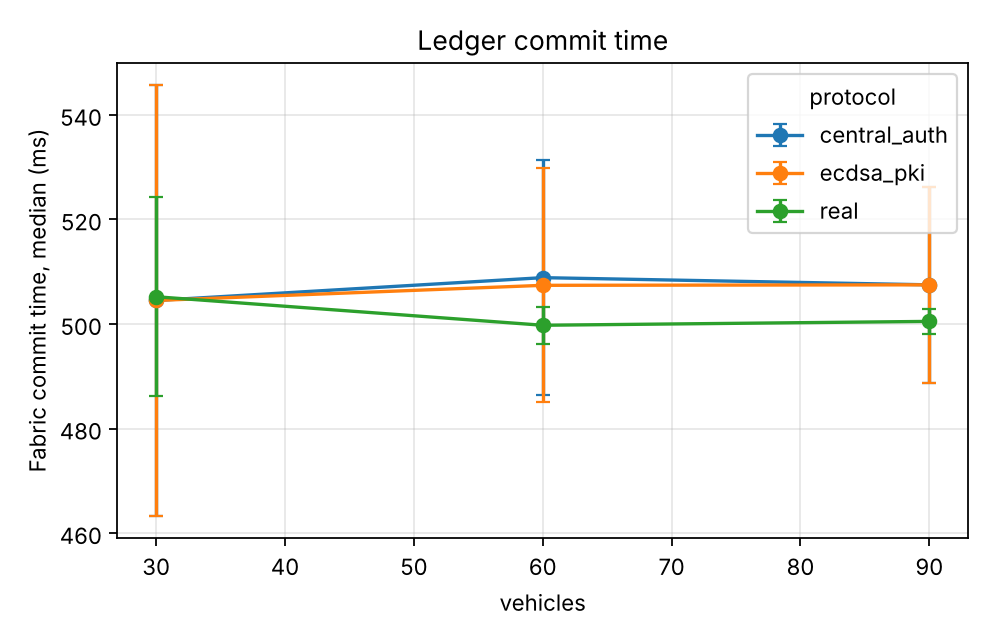
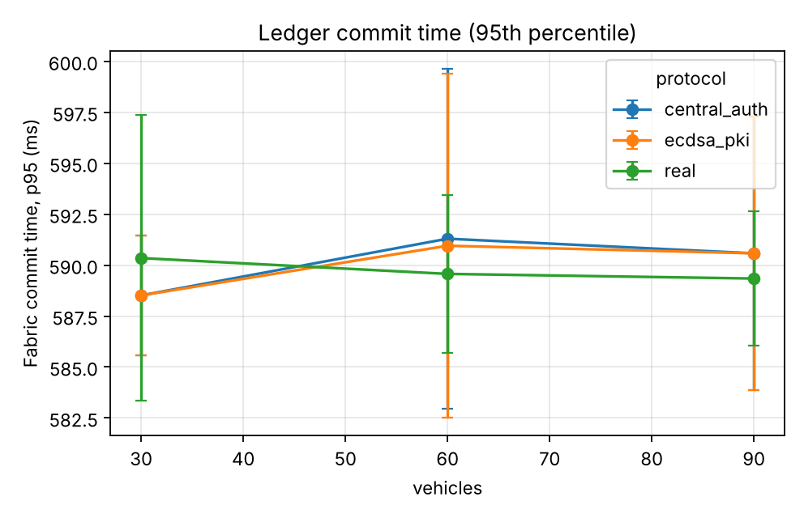
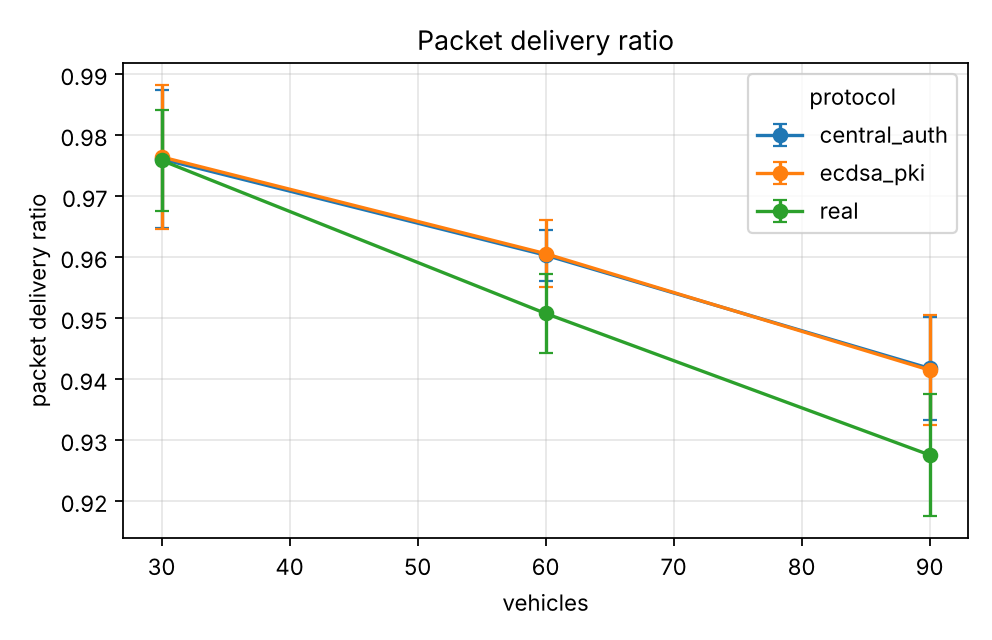
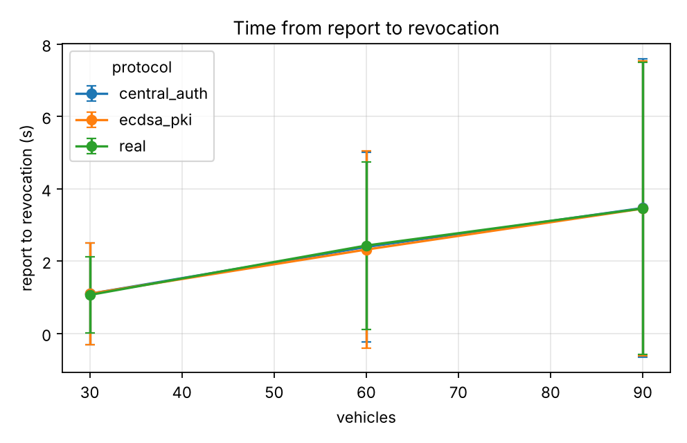

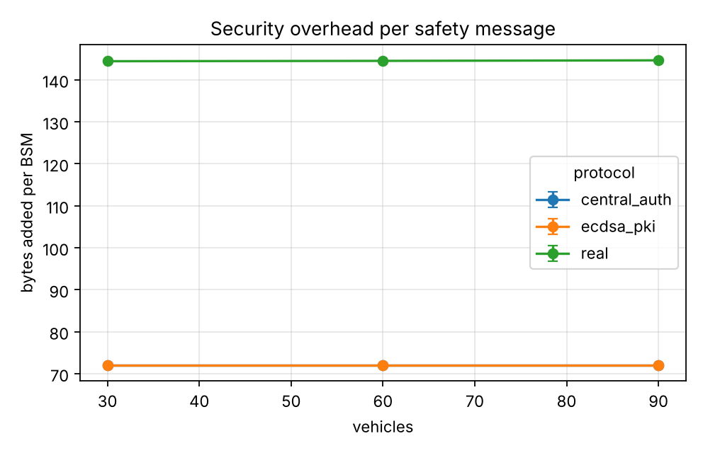
