# Results: realmap_attacks

Mean ± 95 % confidence interval over the seeds. Latencies are simulated time (radio + queueing + the measured compute times). `–` = not measured in this setting.

| metric | attack=const_pos | attack=const_speed | attack=flood | attack=random_pos | attack=random_speed | attack=sudden_stop |
|---|---|---|---|---|---|---|
| auth latency, median (ms) | 2.07 ± 0.16 | 2.05 ± 0.08 | 2.23 ± 0.46 | 2.05 ± 0.08 | 2.10 ± 0.28 | 2.05 ± 0.07 |
| auth latency, p95 (ms) | 7.27 ± 1.36 | 6.72 ± 1.30 | 8.12 ± 3.75 | 6.72 ± 1.30 | 7.15 ± 2.00 | 6.76 ± 1.27 |
| handover latency, median (ms) | 1.51 ± 0.07 | 1.51 ± 0.06 | 1.59 ± 0.38 | 1.51 ± 0.06 | 1.51 ± 0.04 | 1.54 ± 0.17 |
| auth success | 1.000 | 0.998 ± 0.009 | 0.994 ± 0.007 | 0.998 ± 0.009 | 0.997 ± 0.007 | 0.998 ± 0.009 |
| handover success | 0.989 ± 0.009 | 0.988 ± 0.007 | 0.986 ± 0.008 | 0.988 ± 0.007 | 0.989 ± 0.007 | 0.988 ± 0.007 |
| handovers via PREAUTH | 0.27 ± 0.09 | 0.27 ± 0.08 | 0.26 ± 0.08 | 0.27 ± 0.08 | 0.27 ± 0.08 | 0.28 ± 0.08 |
| BSM PDR | 0.933 ± 0.020 | 0.934 ± 0.019 | 0.930 ± 0.015 | 0.934 ± 0.019 | 0.934 ± 0.019 | 0.934 ± 0.019 |
| channel busy (RSU) | 0.034 ± 0.001 | 0.034 ± 0.001 | 0.038 ± 0.002 | 0.034 ± 0.001 | 0.034 ± 0.001 | 0.034 ± 0.001 |
| security bytes / BSM | 145 ± 0 | 145 ± 0 | 145 ± 0 | 145 ± 0 | 145 ± 0 | 145 ± 0 |
| attackers reported | 1.00 | 1.00 | 1.00 | 1.00 | 1.00 | 1.00 |
| attackers revoked | 1.00 | 1.00 | 1.00 | 1.00 | 1.00 | 1.00 |
| first lie -> report, median (s) | 0.27 ± 0.04 | 1.06 ± 0.00 | 0.16 ± 0.01 | 0.27 ± 0.04 | 1.12 ± 0.13 | 1.11 ± 0.09 |
| report -> revocation (s) | 12.04 ± 7.61 | 0.68 ± 0.82 | 0.66 ± 0.73 | 0.68 ± 0.79 | 0.68 ± 0.79 | 0.65 ± 0.76 |
| first lie -> identity reveal (s) | 15.88 ± 10.10 | 3.05 ± 1.01 | 2.15 ± 0.72 | 2.18 ± 0.67 | 3.35 ± 0.53 | 3.71 ± 1.65 |
| honest flagged | 0.7 ± 1.4 | 0.7 ± 1.4 | 0.7 ± 1.4 | 0.7 ± 1.4 | 0.7 ± 1.4 | 0.7 ± 1.4 |
| honest reported | 0.0 | 0.0 | 0.0 | 0.0 | 0.0 | 0.0 |
| honest revoked | 0.0 | 0.0 | 0.0 | 0.0 | 0.0 | 0.0 |
| pseudonym changes / vehicle | 1.9 ± 0.3 | 1.9 ± 0.2 | 1.9 ± 0.1 | 1.9 ± 0.2 | 1.9 ± 0.3 | 2.0 ± 0.2 |
| seeds | 3 | 3 | 3 | 3 | 3 | 3 |

## Which detector checks fired

Counted once per pseudonym and RSU (the first flag). Honest flags alone revoke nothing: a pseudonym is reported after K flagged BSMs out of W, and revoked when 2 different RSUs report it.

| check | flags on attackers | flags on honest vehicles |
|---|---|---|
| heading | 27 | 12 |
| msg_rate | 84 | 0 |
| pos_jump | 84 | 0 |
| pos_speed | 290 | 6 |
| range | 103 | 0 |
| speed_cons | 35 | 0 |

## Figures

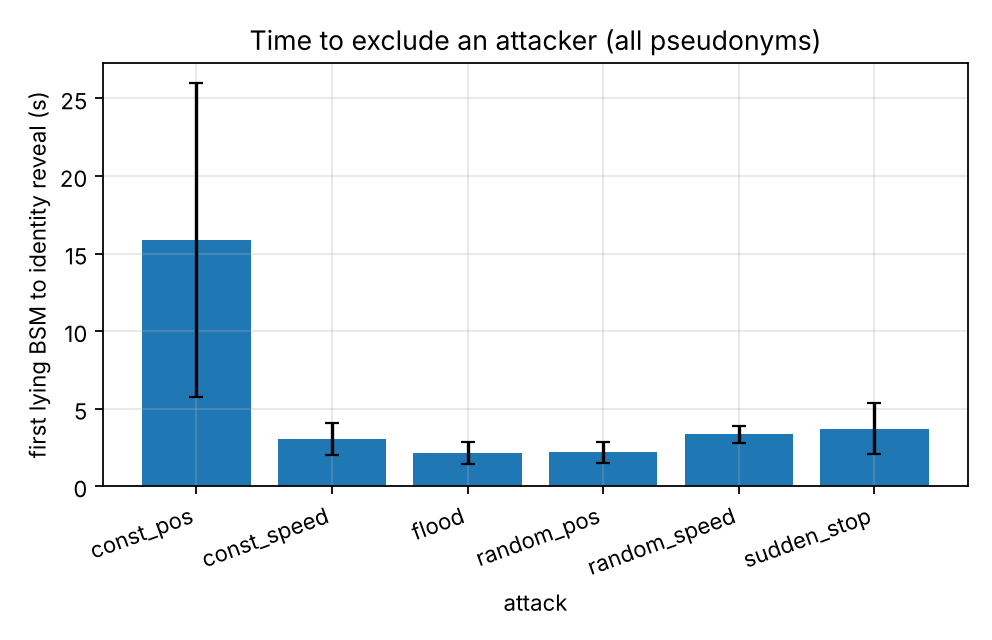
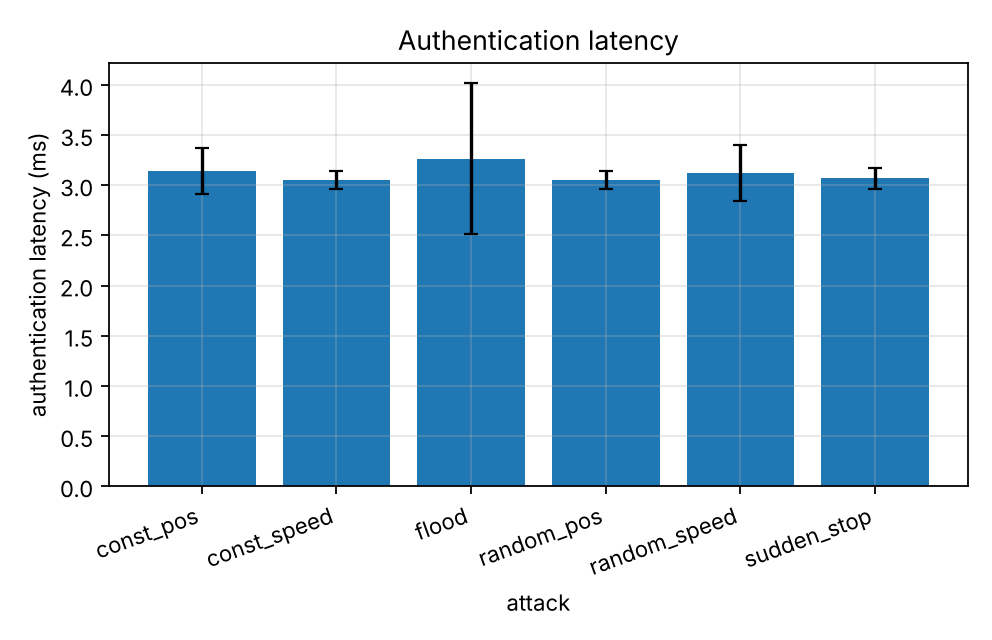
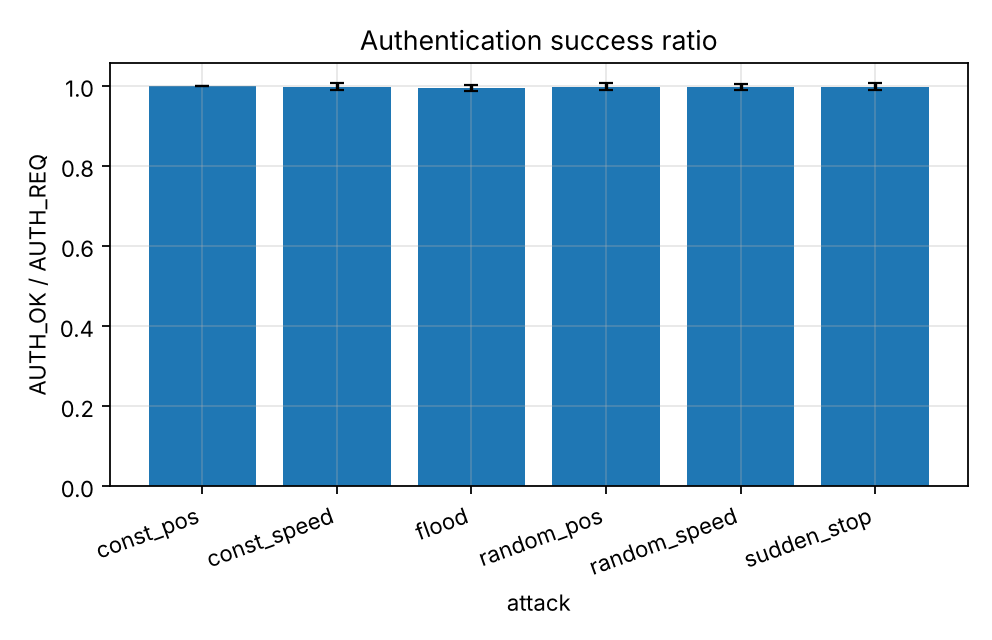
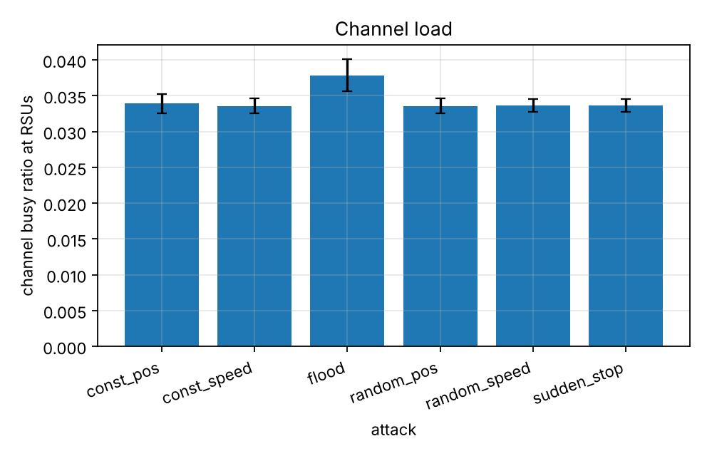

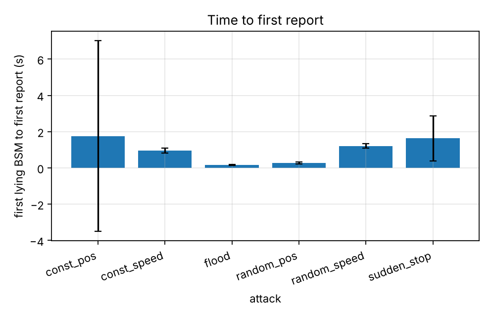
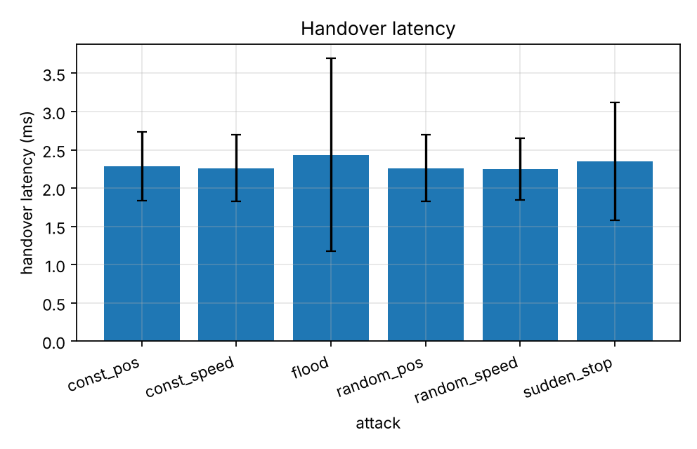
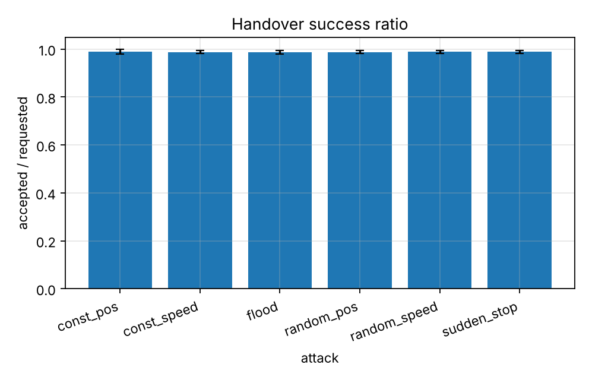
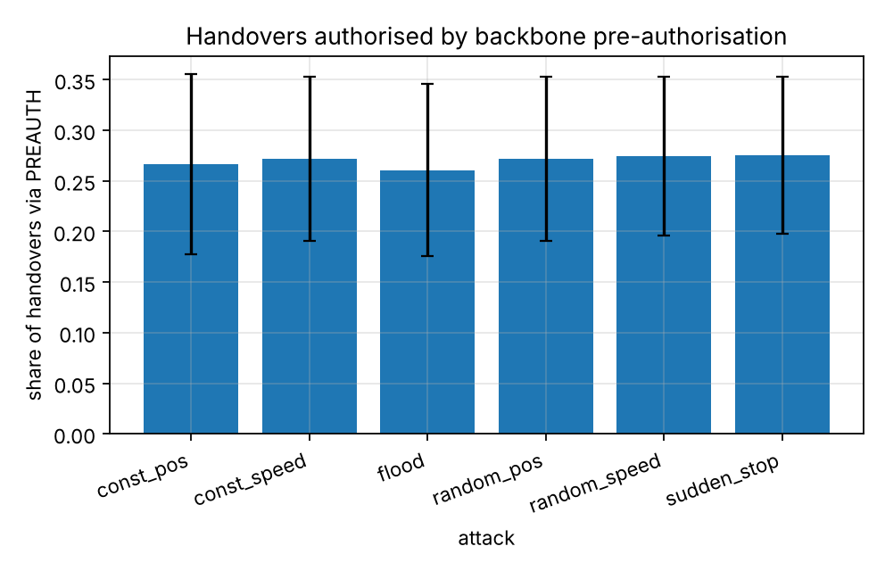
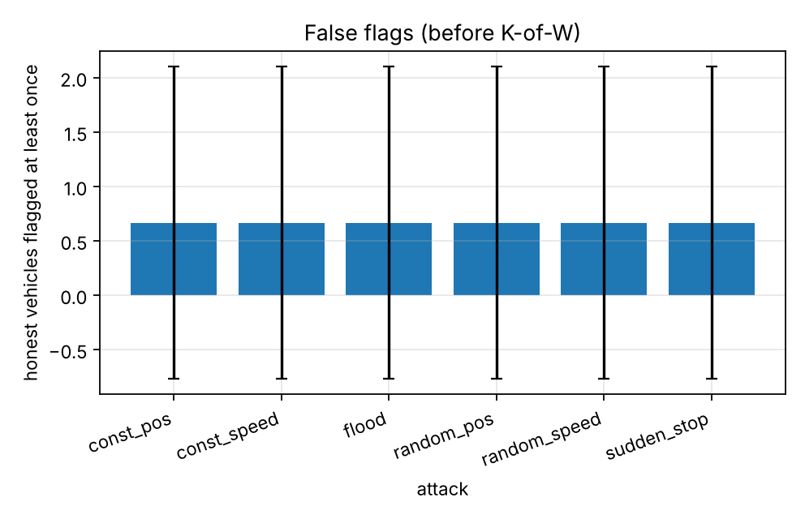
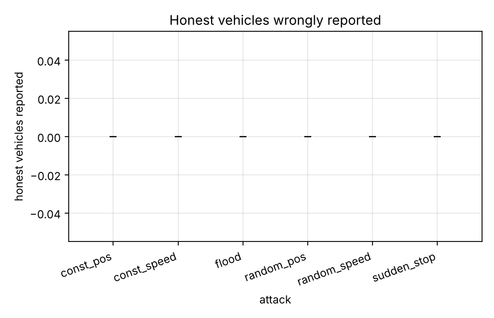
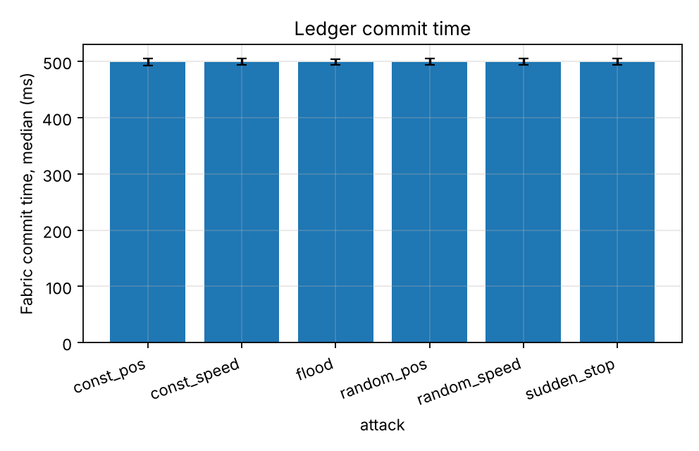
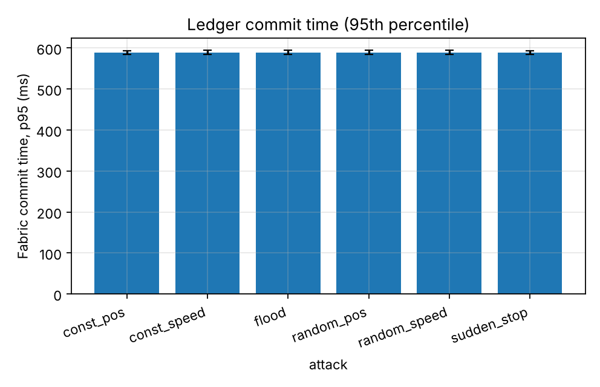
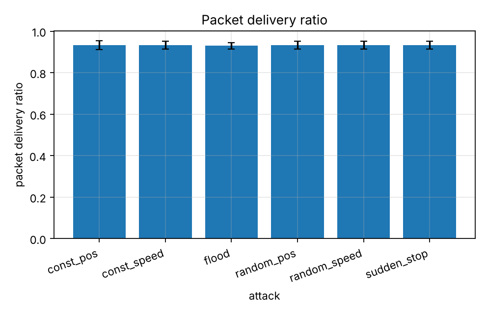
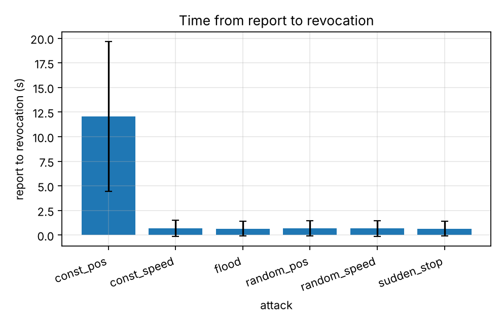
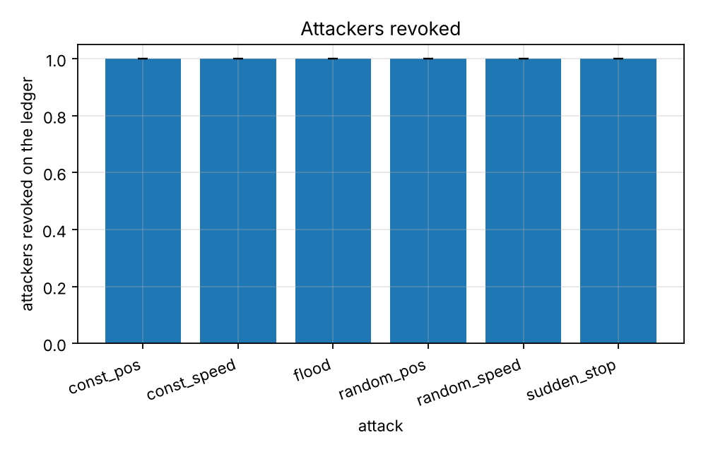
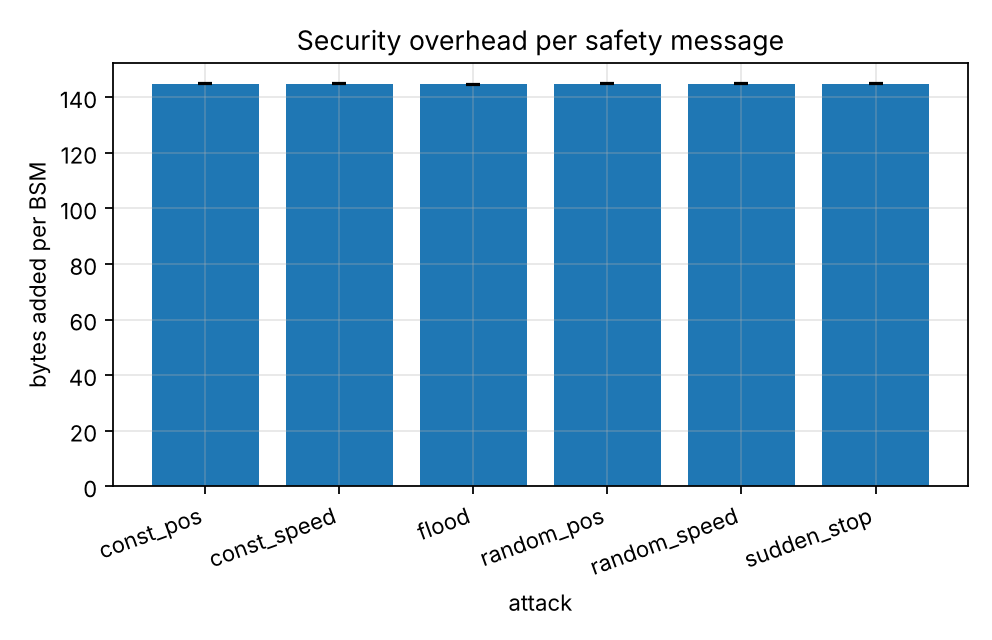
